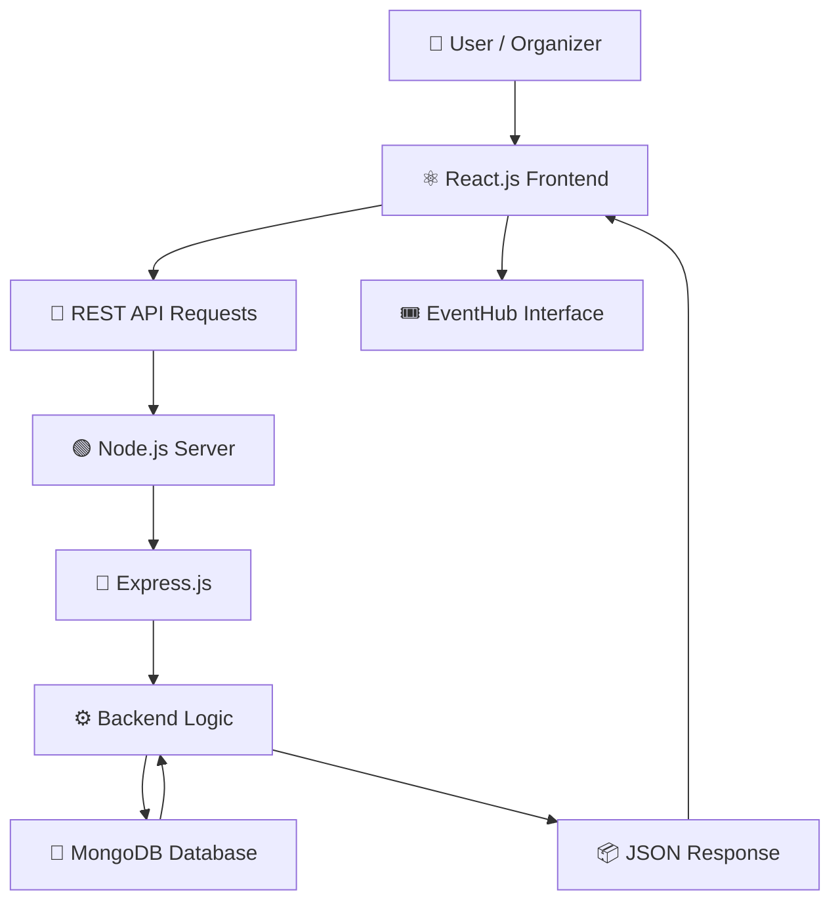

<div align="center">

# 🎟️ EventHub

### Discover. Create. Manage. Experience.

**One Platform. Every Event. Endless Possibilities.**

<br/>


<br/>

**A full-stack event management platform designed to simplify event discovery, registration, organization, and management through a unified digital experience.**

<br/>

</div>

---

## 🌐 About EventHub

**EventHub** is a full-stack web application developed to make event management more accessible, organized, and efficient.

The platform aims to connect event organizers and participants through a centralized system where events can be created, managed, discovered, and registered for.

Built using the MERN technology stack, EventHub combines a responsive React.js frontend with a Node.js and Express.js backend, supported by MongoDB for database management.

Whether managing an event or exploring upcoming experiences, EventHub provides a foundation for a streamlined digital event ecosystem.

---

## 🎯 The Problem

Managing events through disconnected platforms and manual processes can create several challenges:

- Difficulty discovering relevant events.
- Manual event registration processes.
- Complicated event management workflows.
- Disorganized event information.
- Limited centralized event administration.

## 💡 Our Solution

EventHub introduces a centralized event management platform focused on simplifying the complete event lifecycle.

The platform is designed to support:

- Event creation and management.
- Event discovery and exploration.
- Participant registration workflows.
- Organized event information.
- Database-driven event management.
- A responsive user experience.

---

## ✨ Core Features

| Feature | Description |
|---|---|
| 🎫 Event Discovery | Explore and discover available events |
| ➕ Event Creation | Create and publish event information |
| 📅 Event Management | Manage event-related information |
| 📝 Registration | Support participant registration workflows |
| 👤 User Workflows | User-facing application interactions |
| 🗄️ Database Integration | MongoDB-based data management |
| 🔌 REST APIs | Frontend and backend communication |
| 📱 Responsive Interface | Adaptable web application experience |

---

## 🏗️ System Architecture

EventHub follows a full-stack client-server architecture based on the MERN stack.



### Application Workflow

1. Users interact with the EventHub web application.
2. React.js manages the frontend interface.
3. API requests are sent to the backend.
4. Express.js processes incoming requests.
5. Backend operations communicate with MongoDB.
6. Database responses are processed and returned.
7. The frontend displays the updated information.

---

## 🧰 Technology Stack

### Frontend

| Technology | Purpose |
|---|---|
| React.js | User interface development |
| JavaScript | Application logic |
| HTML5 | Web structure |
| CSS3 | Interface styling |

### Backend

| Technology | Purpose |
|---|---|
| Node.js | Server-side runtime |
| Express.js | Backend framework |
| REST APIs | Application communication |

### Database & Development

| Technology | Purpose |
|---|---|
| MongoDB | Database management |
| Git | Version control |
| GitHub | Source code management |
| npm | Dependency management |

---

## 📂 Project Structure

The following represents a suggested modular MERN architecture.

```text
EventHub/
│
├── client/
│   ├── public/
│   └── src/
│       ├── assets/
│       ├── components/
│       ├── pages/
│       ├── services/
│       ├── hooks/
│       ├── context/
│       ├── App.jsx
│       └── main.jsx
│
├── server/
│   ├── config/
│   ├── controllers/
│   ├── models/
│   ├── routes/
│   ├── middleware/
│   ├── services/
│   └── server.js
│
├── .gitignore
└── README.md
```

*Adjust the structure according to the actual repository.*

---

## ⚙️ Getting Started

Follow these steps to run EventHub locally.

### Prerequisites

Make sure you have:

- Node.js installed.
- npm package manager.
- MongoDB installed or an accessible MongoDB connection.
- Git installed.
- VS Code or another code editor.

### 1. Clone Repository

```bash
git clone https://github.com/YOUR-USERNAME/EventHub.git
```

### 2. Navigate to Project

```bash
cd EventHub
```

### 3. Install Dependencies

Install frontend dependencies:

```bash
cd client
npm install
```

Install backend dependencies:

```bash
cd ../server
npm install
```

### 4. Configure Environment Variables

Create a `.env` file inside the server directory.

```env
PORT=5000
MONGODB_URI=your_mongodb_connection_string
```

Add any additional environment variables required by your implementation.

**Important:** Never commit database credentials or sensitive environment variables to GitHub.

### 5. Start Backend Server

```bash
cd server
npm start
```

### 6. Start Frontend

Open another terminal:

```bash
cd client
npm run dev
```

Open the frontend URL displayed in your terminal.

*Commands and directory names may need adjustment based on the actual package.json configuration.*

---

## 🔐 Development Considerations

EventHub's future development can focus on:

- Secure user authentication.
- Event ownership and authorization.
- Input validation.
- Protected API endpoints.
- Secure database operations.
- Reliable registration workflows.
- Error handling and API validation.

---

## 🛣️ Development Roadmap

| Phase | Development | Status |
|---|---|---|
| 01 | Project Architecture & Setup | 🟡 |
| 02 | React.js Frontend Development | 🟡 |
| 03 | Backend API Development | 🟡 |
| 04 | MongoDB Integration | 🟡 |
| 05 | Event Management Workflows | ⚪ |
| 06 | Registration Management | ⚪ |
| 07 | Testing & Optimization | ⚪ |
| 08 | Production Deployment | ⚪ |

---

## 🔮 Future Scope

EventHub has the potential to evolve into a comprehensive event management ecosystem.

Potential future enhancements:

- 🤖 AI-powered event recommendations.
- 📊 Event analytics dashboard.
- 🎟️ Digital ticket generation.
- 📧 Automated email notifications.
- 💳 Online payment integration.
- 📱 Mobile application support.
- 📍 Location-based event discovery.
- 👥 Advanced organizer management.
- 📈 Participant engagement analytics.

*These are proposed future enhancements and are not claims of currently implemented functionality.*

---

## 🎯 Our Vision

We believe organizing and discovering events should be simple, accessible, and efficient.

EventHub aims to bring organizers and participants together through technology, creating a centralized platform that makes event management easier and more connected.

**Discover Opportunities. Create Experiences. Connect People.**

---

## 👨‍💻 Author

<div align="center">

### Taufiq Shaikh

**AI Engineer | Full-Stack Developer | Technology Enthusiast**

Focused on building modern applications, scalable systems, and meaningful digital experiences.

[](https://github.com/taufiq-shaikh-tech)

</div>

---

<div align="center">

# 🎟️ EventHub

### Every Event Has a Story. Let's Create Yours.

**Discover. Connect. Experience.**

<br/>

⭐ If you find this project interesting, consider giving it a star!

</div>
